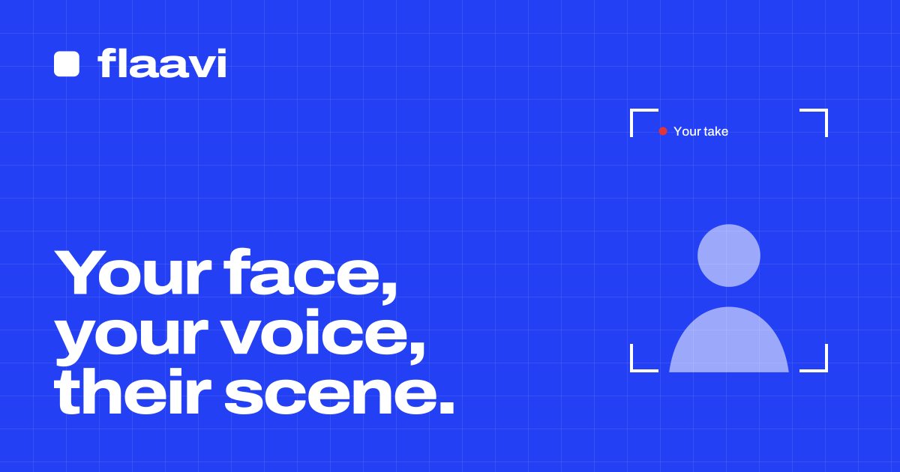
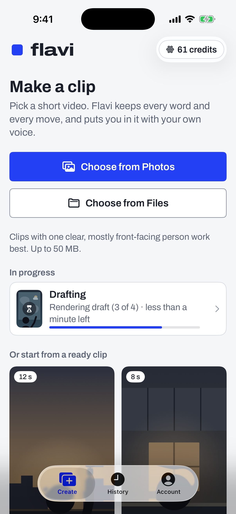
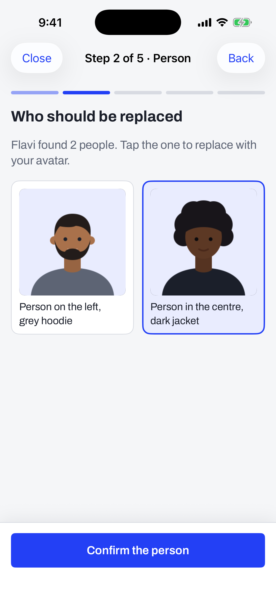
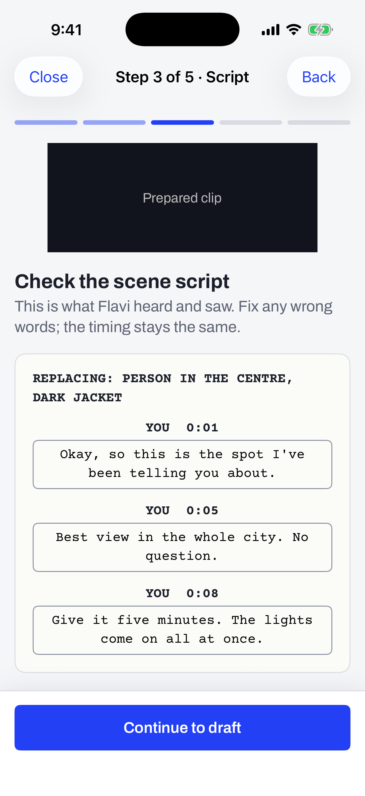

# Flaavi

**Put anyone in your favorite scene, in their own voice. Consent-first AI video, built and shipped solo.**

**Live:** [flaavi.app](https://flaavi.app) &nbsp;|&nbsp; **Status: launching October 2026, live payments**

---

## What it does

Pick a short clip, put yourself, a friend who said yes, or a character you invent into it, and keep every line and move from the original. Flaavi prepares the clip, writes a scene script, renders a quick draft, and finishes it in 720p or 1080p in the person's own voice.

- Real people only with their OK: an explicit consent step, automatic public-figure and minor checks on every face, and a provenance tag on every video.
- Pay as you go or monthly plans; credits tied to rendered seconds, so the price follows the real cost.
- Two to four people replaced in one clip, a "fix a moment" tool, versions, and exports for TikTok and Reels.

| Pick a clip | Choose who goes in | Check the scene script |
|---|---|---|
|  |  |  |

---

## How it's built

| Layer | Technology |
|---|---|
| Web app | Next.js (App Router), TypeScript, Tailwind CSS, on Vercel |
| API | Python, FastAPI, on Vercel |
| Database and auth | Supabase Postgres with row-level security, a double-entry credit ledger (reserve, capture, release, idempotency keys, per-user locks), Supabase Auth with Turnstile and Google sign-in |
| Render worker | Python on Modal: depth, SAM masks and face mesh prep, then fal (Seedance 2.5) for the video |
| Voice and lip-sync | ElevenLabs voice cloning and speech-to-speech; sync.so with a fal fallback |
| Safety | AWS Rekognition and Comprehend, output scans, C2PA provenance, takedown flow |
| Payments | Stripe (plans, credit packs, customer portal, Radar), exact fees recorded per payment |
| iPhone app | SwiftUI, with a shared Swift package and StoreKit |
| Ops | Admin console (revenue, funnel, retention, failures, reliability), SEO pages with JSON-LD and IndexNow |

### Engineering details worth a look

- **Never pay twice.** Paid render requests are never retried automatically; every provider call is resumed from a saved request ID, and every credit movement carries an idempotency key.
- **Credits in Postgres, not the client.** Prices are computed on the server from one pricing file shared by the web app, the API, the worker and the iPhone app; the client only shows them.
- **Fails closed.** If the safety provider is unavailable, nothing that needs a check runs.
- **Tested.** Over a thousand Python tests, web tests, Swift tests and SQL checks, with every provider mocked.

---

*The product code is private. This repository is a public overview.*
